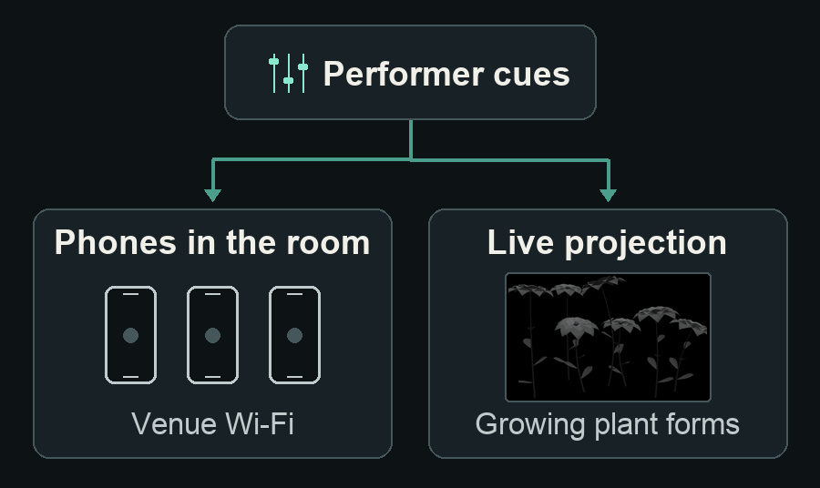
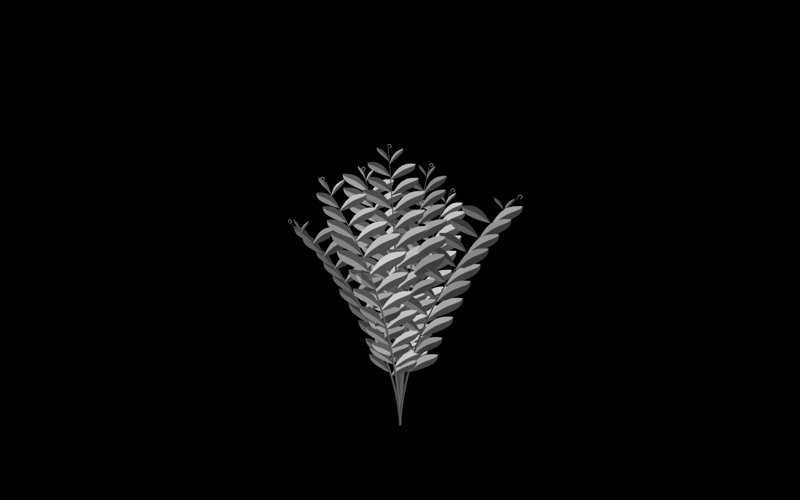
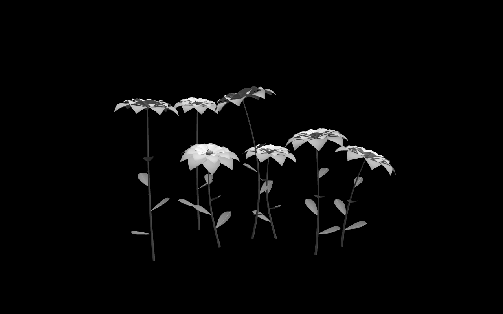

# Swarm

**A gallery performance for distributed sound and live projection**

In a dark gallery, a short tone sounds from a phone on one side of the room. Another phone answers. Circles move on their screens while pale fronds and flowers unfold across a large projection. The piece uses the placement of the phones to compose with distance. Listeners can hear where a call begins and where its answer comes from.

## Phones as instruments

The artist places a small group of phones around the gallery. Each phone joins the venue’s Wi-Fi, opens a browser page, and becomes ready to play when someone taps **Enable sound**. The performer can cue one phone or several together. Each phone makes short tones and beeps through its own speaker and draws a circle on its screen. It also has its own volume and mute controls.

*Illustration of the planned gallery setup. The phones and the projection are two parts of the same performance.*

In a later version, visitors could join the same way with their own phones. Their speakers and screens would add more points of sound and light wherever they are in the room.

## How the projection grows

The projection is drawn live, frame by frame. The performer can change how far the plants grow, how widely they open, and how much they sway. A short cue can send a bend through the stems. The same forms can slowly unfold across a passage or move in response to a single accent.

### Branching Garden

Fronds rise from a shared base and unfurl into a dense, moving cluster.

### Bloom Colony

Separate stems carry layered flowers that open from upright buds into broad crowns.

## Project stage

The phone instrument and both projection studies exist as separate prototypes. The next stage is to bring them together in the gallery and rehearse how sound, screens, and projection respond across the room.
