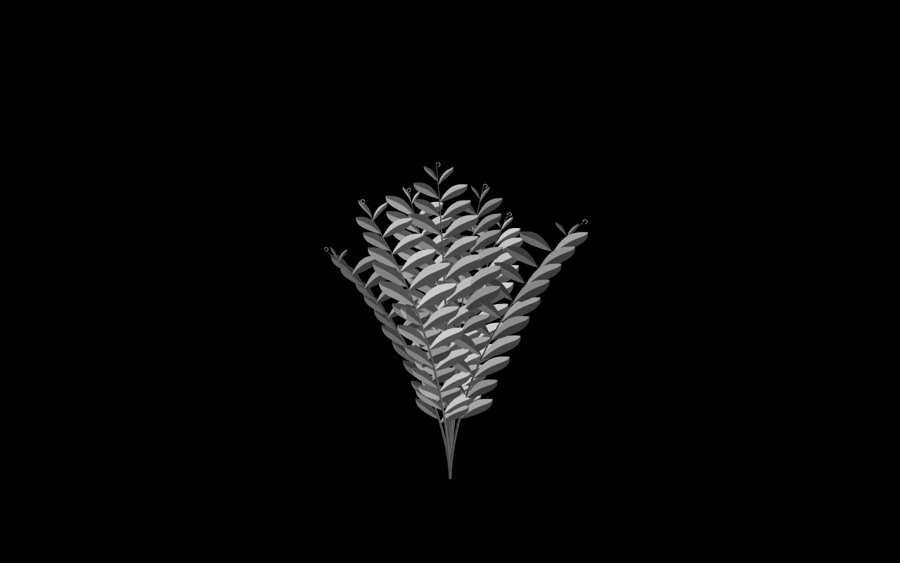
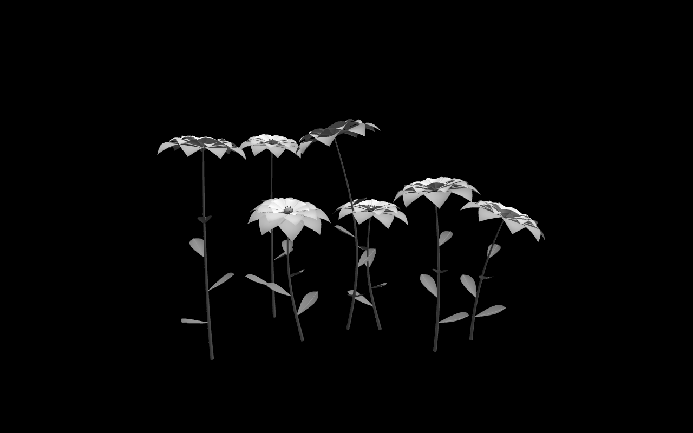

# Processing plant studies

Two live 3D botanical studies for Nervengarten’s projection prototype. Both use Processing Java Mode/P3D, grayscale geometry on true black, seeded shapes, and elapsed-time animation. The phones continue using the existing Web Audio/p5.js instrument.

## Open and run

Open `BranchingGarden/BranchingGarden.pde` or `BloomColony/BloomColony.pde` in Processing 4 and press Run. Keep the other tabs and `code/` directory with each sketch. oscP5 is bundled, including its license and released source; no library installation is required.

- **Branching Garden:** curved fronds grow from a shared root, paired leaves unfold, and curled tips remain visible. Best for gathering, pressure, and collective motion.
- **Bloom Colony:** curved stems carry layered flowers that open from upright buds into wide crowns. Best for recruitment, flowering, and an expanded collective field.

Demo mode starts with developed plants and slowly varies growth and opening. Arrows allow the full seedling-to-grown range. Density selects a stable subset of 3–9 plants. A hit flexes the geometry without flashing the screen.

## Manual controls

| Input | Effect |
|---|---|
| Drag mouse | Orbit and tilt the 3D view |
| Up / Down | Increase / decrease growth; enter manual mode |
| Right / Left | Open / close leaves or petals; enter manual mode |
| Space | Elastic hit gesture |
| D | Toggle automatic demo; leave remote mode |
| R | Generate a new seeded arrangement |
| B | Toggle explicit blackout |
| P | Pause time-based motion |
| H | Show/hide help; hidden by default |
| S | Save the current frame into the sketch's `captures/` folder |

Pause freezes time-based motion; remote state changes still apply. For projector output, replace `size(1280, 800, P3D)` in the sketch's `settings()` with `fullScreen(P3D, 2)` for display 2. Use one of those calls. Verify display numbering first. A single projected sketch is the intended live setup; both may run together for comparison.

## SuperCollider

Open `plants-control.scd` and evaluate its first block. It sends to both sketches; uncomment a single-target line to address only one. Change `~plantState`, trigger `~plantSend.value("/plant/hit", [0.8])`, and stop with `~plantStop.value`. This example creates no audio and does not load or replace the phone master.

| Loopback OSC address | Arguments |
|---|---|
| `/plant/state` | Five OSC floats: growth, bloom, wind, density, light; each 0–1 |
| `/plant/hit` | One OSC float, 0–1 |
| `/plant/blackout` | One OSC integer, 0 or 1 |
| `/plant/reset` | One OSC integer seed |
| `/plant/heartbeat` | No arguments |

BranchingGarden listens on **127.0.0.1:57122**; BloomColony listens on **127.0.0.1:57123**. The existing phone gateway remains at 57121. OSC numeric types are checked: use `.asFloat` for state/hit values and integers for blackout/reset.

The first state leaves demo mode. Once remotely controlled, three seconds without state/heartbeat causes blackout; a fresh state restores control, while heartbeat alone does not rearm it. Explicit blackout stays active until cleared. Incoming data is validated and queued for the render thread with bounded storage. These prototypes react on receipt; they do not implement future-timestamp audiovisual alignment.

## Verification

On 2026-11-10 both sketches compiled and rendered with Processing 4.5.7 on this Mac. The previews above are actual sketch renders. Protocol checks cover malformed types/arity, finite values and bounds. A real loopback UDP check covers state, hit, explicit blackout, control expiry, fresh-state recovery, and seeded geometry in both sketches.

Run `sh check.sh` to repeat compilation and the control checks using this Mac's installed Processing runtime. It uses temporary build folders and a temporary loopback port. The system's old `processing-java` launcher points to a removed app directory; this script uses the current bundled compiler directly.

Projector brightness/readability, long-run frame rate alongside live audio, physical Akai mapping, and acoustic/visual synchronization still need rehearsal. Adjust line/geometry scale and white level on the actual projector before performance.
